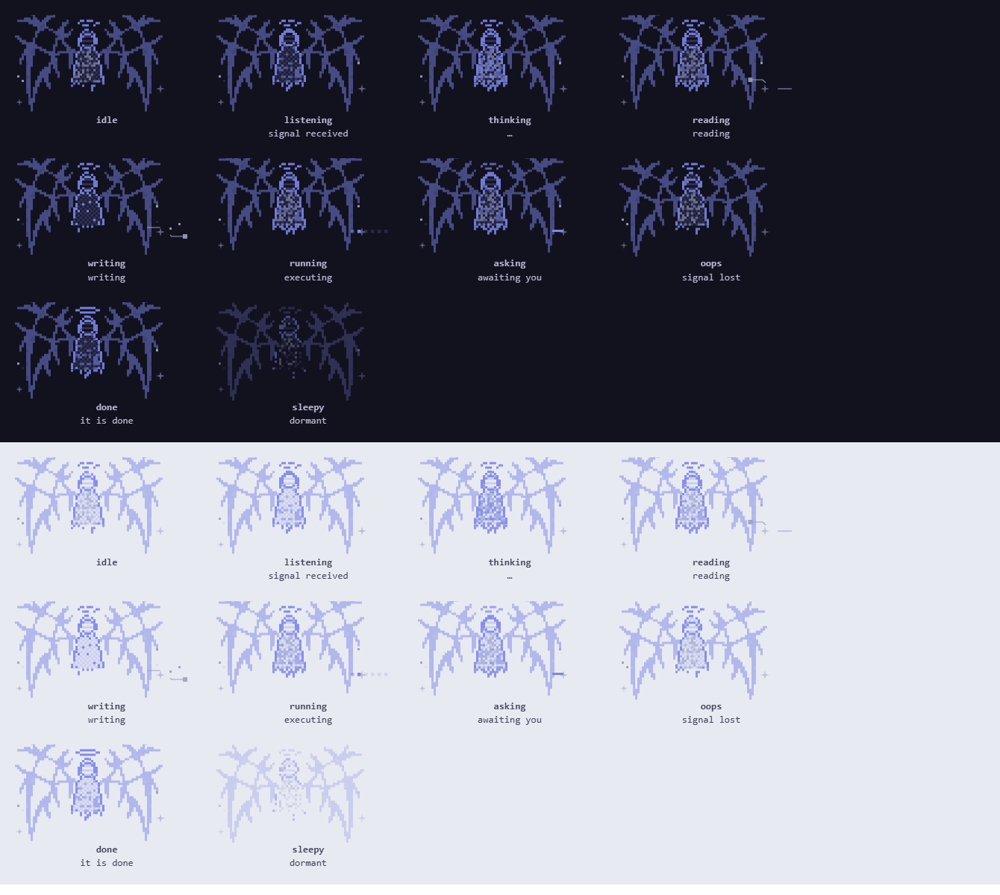

# Wired Angel pet

A small animated pet for Claude, made to sit with the [Wired Angel](https://github.com/ignisviotto/wired-angel) theme:
a veiled, faceless angel of static with pixel sigil wings and a broken halo. It keeps watch above the message box and
answers, quietly, to what Claude is doing.



| Claude is… | The angel… |
|---|---|
| idle | keeps still; its static shimmers, with a brief glitch now and then |
| hearing your message | lifts its head; the halo flickers once |
| thinking | its static thickens and quickens |
| reading | a wire draws itself in beside it |
| writing | a wire runs out to a node |
| running a command | raises its wings while a row of pixels ticks |
| waiting on you | waits beside a blinking cursor, halo pulsing |
| hitting a snag | takes one hard glitch, then bows its head |
| done | its halo closes and steadies |
| idle for five minutes | dims and half dissolves into static |

## Install

At the prompt of a terminal session:

```
/plugin install wired-angel-pet --marketplace ignisviotto/wired-angel-pet
```

Answer `y` to add the marketplace, then pick a scope. Or from a shell:

```
claude plugin install wired-angel-pet --marketplace ignisviotto/wired-angel-pet
```

## Use

`/angel hide`, `/angel show`, `/angel big`, `/angel small`. The choice is remembered across sessions. In a terminal the
angel is a small text glyph. All animation stops under "reduce motion". It reads on both a dark and a light ground, with
or without the theme.

## Changing the art

`hooks/pet-art.js` is generated. The drawing (figure rows, wing curves, moods, captions) lives in `build-angel.mjs`;
run `node build-angel.mjs hooks` to rebuild it, and open the `pet-preview.html` it writes to see every mood on a dark
and a light ground (`?one=idle&x=8` for a close-up).

All art is original. MIT.
